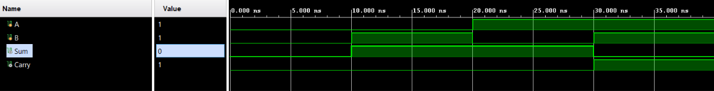

# Half Adder – Verilog RTL Design

## Overview
Implementation and functional verification of a 1-bit Half Adder using Verilog HDL in AMD Vivado 2025.2.

## Target Platform
- FPGA Board: PYNQ-Z2
- FPGA Device: XC7Z020-1CLG400C
- HDL: Verilog
- Simulator: Vivado Simulator (XSim)

## Design Equations
- Sum = A XOR B
- Carry = A AND B

## Verification
A Verilog testbench was developed to verify all four possible input combinations.

| A | B | Sum | Carry |
|---|---|---|---|
| 0 | 0 | 0 | 0 |
| 0 | 1 | 1 | 0 |
| 1 | 0 | 1 | 0 |
| 1 | 1 | 0 | 1 |

## Simulation Results
Behavioral simulation completed successfully using Vivado Simulator.

## Tools Used
- AMD Vivado 2025.2
- Verilog HDL
- Vivado Simulator (XSim)
