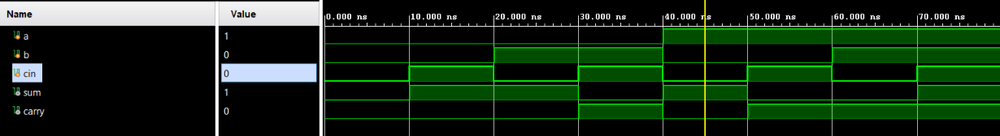

# Full Adder Using Two Half Adders – Verilog HDL

## 1. Project Overview

This project implements a 1-bit Full Adder using two Half Adder modules and one OR gate through structural modeling in Verilog HDL.

The design demonstrates hierarchical module instantiation and hardware reuse, where an existing Half Adder module is used as a building block to construct a more complex arithmetic circuit.

## 2. Hardware Specifications

| Parameter | Description |
|---|---|
| Design | 1-bit Full Adder |
| Design Methodology | Structural Modeling |
| HDL | Verilog |
| FPGA Board | PYNQ-Z2 |
| FPGA Device | XC7Z020CLG400-1 |
| Development Tool | AMD Vivado 2025.2 |
| Simulator | Vivado Simulator (XSim) |

## 3. Full Adder Architecture

The Full Adder consists of:

- Two Half Adder modules
- One OR gate
- Three inputs: A, B, Cin
- Two outputs: Sum, Carry

### Boolean Expressions

**First Half Adder:**

S1 = A XOR B

C1 = A AND B

**Second Half Adder:**

Sum = S1 XOR Cin

C2 = S1 AND Cin

**Final Carry Output:**

Carry = C1 OR C2

## 4. Truth Table

| A | B | Cin | Sum | Carry |
|---|---|---|---|---|
| 0 | 0 | 0 | 0 | 0 |
| 0 | 0 | 1 | 1 | 0 |
| 0 | 1 | 0 | 1 | 0 |
| 0 | 1 | 1 | 0 | 1 |
| 1 | 0 | 0 | 1 | 0 |
| 1 | 0 | 1 | 0 | 1 |
| 1 | 1 | 0 | 0 | 1 |
| 1 | 1 | 1 | 1 | 1 |

## 5. Verification and Simulation

A separate Verilog testbench (`tb_full_adder_using_HA.v`) is used to verify the functionality of the Full Adder.

All eight possible input combinations are tested using nested `for` loops.

Behavioral simulation is performed using the Vivado Simulator (XSim).

### Simulation Waveform

## 6. Project Files

| File | Description |
|---|---|
| `full_adder_using_HA.v` | Structural RTL implementation |
| `tb_full_adder_using_HA.v` | Testbench for functional verification |
| `Simulation_waveform.png` | Behavioral simulation waveform |
| `ReadMe.md` | Project documentation |

## 7. Learning Outcomes

- Understanding structural modeling in Verilog.
- Implementing hierarchical module instantiation.
- Reusing existing RTL modules.
- Understanding intermediate carry generation.
- Developing exhaustive testbenches.
- Performing behavioral simulation using Vivado.

## 8. Applications

Full Adders are fundamental building blocks in digital arithmetic circuits and are widely used in:

- Arithmetic Logic Units (ALUs).
- Ripple Carry Adders.
- Multiply-Accumulate (MAC) datapaths.
- Digital signal processing hardware.
- FPGA-based computing architectures.
